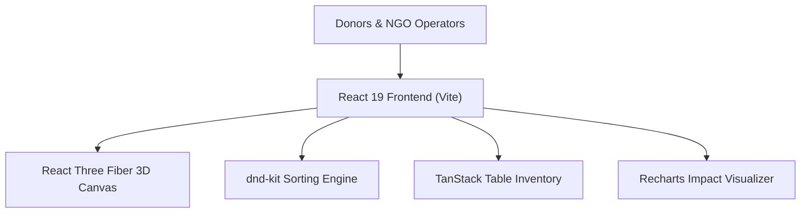

# 🍲 Food Rescue & Redistribution Platform (Srijan '26)

[](https://artlinger2331.github.io/Srijan26_SnapSyntax_Binarysqad/)
[](#)
[](#)
[](#)
[](#)
[-blueviolet)](#)

> **Developed for Srijan '26 (Jadavpur University's Annual Techno-Management Fest) by Team Binarysqad (SnapSyntax).**  
> An intelligent, 3D-enhanced food waste mitigation and redistribution platform connecting food donors (restaurants, events, caterers) with local NGOs and distribution centers in real-time.

---

## 🌐 Live Application Demo

🔗 **Experience the live deployment:** [**Srijan'26 Food Platform Live**](https://artlinger2331.github.io/Srijan26_SnapSyntax_Binarysqad/)

---

## ⚡ Key Highlights & Innovation

- 🎮 **Interactive 3D Visualizer:** Powered by **React Three Fiber (R3F)** and **Drei**, rendering real-time 3D planetary and logistics elements.
- 📦 **Drag-and-Drop Batch Management:** Seamless logistical sorting of food packages and meal deliveries built with **@dnd-kit**.
- 📊 **Dynamic Analytics Dashboard:** Visual donation volume trends and impact reporting driven by **Recharts**.
- 📋 **High-Performance Data Grids:** Fast, filterable donation inventory powered by **TanStack Table v8**.
- ✨ **Fluid Micro-Interactions:** Modern UI animations orchestrated via **Framer Motion** and **Tailwind CSS v4**.

---

## 🏗️ Technical Architecture



### Stack Breakdown

- **Core Framework:** React 19, Vite 8, Modern ECMAScript Modules
- **Styling:** Tailwind CSS 4 (`@tailwindcss/vite`), clsx, tailwind-merge
- **3D Graphics:** Three.js, `@react-three/fiber`, `@react-three/drei`
- **Component Utilities:** Lucide React icons, `@dnd-kit/core`, `@tanstack/react-table`

---

## 🚀 Running the Project Locally

### Prerequisites
- [Node.js](https://nodejs.org/) (v18+)
- `npm` or `pnpm`

### Installation & Execution

```bash
# Clone the repository
git clone https://github.com/avrojitsaha763-byte/jadavpurproject1.git
cd jadavpurproject1

# Install dependencies
npm install

# Start development server
npm run dev
```

Visit `http://localhost:5173` to explore the app with Vite Hot Module Replacement (HMR).

### Building for Production
```bash
npm run build
npm run preview
```

---

## 👥 Hackathon Team & Acknowledgements

- **Event:** Srijan '26 • Jadavpur University
- **Team:** `Binarysqad` (SnapSyntax)
- **Contributors:** [Avrojit Saha](https://github.com/avrojitsaha763-byte) & Team

---

## 📄 License

Distributed under the MIT License.
